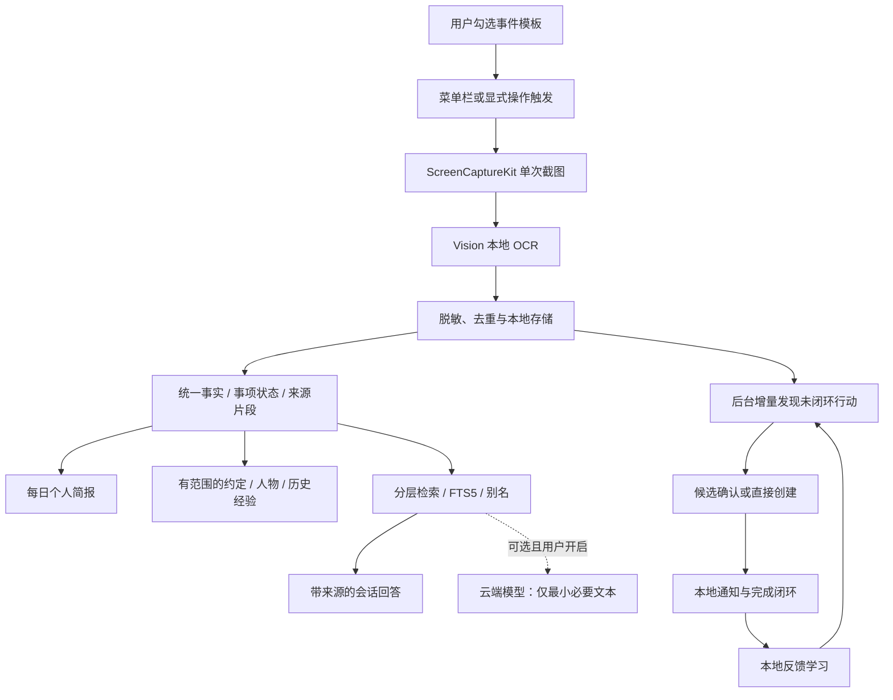

# Recall

> **找回经历、串联进展、接续思考的 macOS 个人记忆助手。**

Recall 将用户主动保存的记录整理为可搜索、可追溯的本地记忆，帮助回答“上次谈到哪了”“当时为什么这样决定”“这件事后来怎么样了”。记忆脉络把跨日期、跨应用的同一主题串联起来，每日回顾回顾一天，问一问从积累中寻找答案，提醒承接用户明确安排的行动。随着记录积累，应用在有来源支持的前提下连接相关经历，帮助用户接续工作与思考；用户可以查看来源、更正内容或删除记录。

## 核心原则

Recall 的默认行为是 **本地优先、明确触发、可追溯、可删除**。它不会默认监听裸 Enter，不会默认连续截图，也不会默认把截图或完整历史发送到云端。用户可在“记录管理”中明确启用 Enter 键触发记录；该规则默认关闭、可随时暂停，且仅在 Recall 不在前台时响应。每条回答关联本地记忆来源；每个提醒都必须由用户确认后才能创建。

## 已实现功能

| 能力 | 当前实现 |
|---|---|
| 事件模板 | 提供 9 个可独立启用、配置和关闭的记录模板，包括手动记录、工作节点、网页研究、会议、待办、文档里程碑、任务切换、每日回顾和默认关闭的 Enter 键触发记录。 |
| 显式采集 | 使用菜单栏入口与“记录此刻”窗口触发；支持当前窗口、当前显示器与仅文本三种范围。 |
| 本地 OCR | 通过 `Vision` 的 `VNRecognizeTextRequest` 在设备端提取中文和英文文本，保留有效正文的文字位置与识别质量。 |
| 后台理解记录 | 可选择让已连接的模型分段核对脱敏文字，区分具体事情、说话人与负责人、状态、时间和条件；独立复核后保存带原文片段的结果，供回顾、问答、主题和提醒共用。原始 OCR 不被覆盖。 |
| 本地记忆 | 将时间、来源应用、OCR、摘要、标签和可选截图保存在 `~/Library/Application Support/Recall/`。 |
| 记忆脉络 | 通过“进行中、全部主题、一周回顾、记忆与约定”串联跨日期的具体事情与经历；支持补充记录、查看来源、更正、约定有效期、别名与历史经验。 |
| 搜索与问答 | 按问题意图、日期、主题和别名检索，必要时按需语义定位并回查原文；跨日问题保证日期覆盖，适用约定独立进入有预算的上下文。 |
| 个人简报 | 围绕“今天推进了什么、接下来要处理、值得留意”组织有依据的内容，空栏目不显示；与脉络、问一问和周回顾共享事实归属及状态。 |
| 项目与工作 Episode | 将同一事项的原文与变化整理为工作片段，保留具体成果、最新状态、明确后续行动及来源版本，支持同屏多个事项。 |
| 可校正的长期记忆 | 明确的“记住”当场生效；普通记录在本地后台整理为有依据的记忆。按场景区分约定，处理冲突、替代、过期、停用与级联遗忘，无需逐条确认。 |
| 记录线索与覆盖诊断 | 保存内容无需包含第一人称行动句，也能以中性线索参与个人回顾；区分原始记录、所选日期内记录、本人事项、约定和经验的数量。 |
| 反馈学习 | 洞察支持“准确 / 部分准确 / 不准确”；连续负反馈会抑制同类洞察。重复出现的工作模式只作为候选，用户启用后才影响建议。 |
| 本地智能索引 | JSON 保存状态，SQLite WAL + FTS5 按变化行增量更新；失败回退内存检索并重建。 |
| 模型接入 | 提供可编辑的 OpenAI 与 Anthropic 兼容接口；地址、模型、API Key 均可配置，密钥作为普通文本仅保存于用户本机 Recall 配置。 |
| 智能提醒 | 后台增量分析用户允许参与的本地记忆，过滤疑问、完成态、代码与界面噪声，识别待办、承诺、截止时间与重复周期；支持直接创建、确认候选、稍后提醒、修改、完成、取消、来源追溯和通知快捷操作。 |
| 隐私控制 | 支持暂停采集、截图开关、应用 Bundle ID 排除列表、基本敏感信息脱敏与记录删除。 |
| 记忆治理 | 支持时间线单条/批量删除、删除影响预览、总结条目级管理、彻底忘记来源、7 天最近删除与恢复，以及按删除原因学习的本地忽略规则。 |

## 信息流



## 后台理解记录

在 **设置 → 记忆 → 采集后自动理解新记录** 开启，默认关闭。还需要已配置模型、允许使用脱敏文本。开启后仅增量整理之后保存的记录；新记录保存后会唤起后台整理，每批最多串行处理三段，逐段保存并让位给主动生成的回顾；失败遵守退避时间。已有内容可点“整理近 30 天记录”，或在记录详情中单独“重新整理”。不需要逐条确认理解结果，正式提醒仍需用户安排。

识别文字先落盘，整理在后台按段进行，不阻塞采集或提问。长文本分段覆盖全文，相邻聊天只有在来源、窗口、时间与完整消息重合时才补充上下文；不会仅因来自同一个聊天工具就拼接。每段必须交代已处理的片段；结果需要逐字来源验证和第二次独立语义核对。无法判断的内容保留为未知；有效空结果不会触发关键词兜底再次生成噪声。

记录详情中的“理解这条记录”可查看完整结论、说话人、原文时间与依据，支持更正识别文字、重新整理或删除整理结果。更正以单独版本保存，原文仍保留；删除来源或更正后，依赖旧内容的理解与派生结果会失效，并重新核对。历史已保存回顾不会仅因首次后台整理就自动重写，可按需重新生成；来源更正、删除仍执行现有失效与删除规则。

暂停或关闭应用后不再开始新的请求，未完成任务持久化并在恢复后继续。连接失败或核对不通过最多自动尝试三次，之后可在进度列表手动重试。进度列表可逐页查看全部任务；日志只记任务状态和安全错误类别，不记正文、模型响应或密钥。此功能使用配置的模型服务并产生相应调用费用；不发送截图，也不新增屏幕采集。

已整理的本人承诺只有在对象、行动、归属明确且尚未完成时才进入提醒候选；对方的陈述、资料观点、条件性提议与已完成事项不变成自己的待办。原文中的相对日期保留原样，没有时钟的日期不会被补成默认 9:00；采集时间、原文消息时间、原文发生时间与截止时间分别保存。未启用、未完成或连接失败的记录继续使用原有本地能力。模型理解仍可能出错，不能恢复原图未拍到的内容。

## 时间线：短预览与完整证据

时间线以内容片段作为标题，记录方式（如 Enter 触发）降为辅助信息。两行预览由本地规则提取，过滤聊天角色标记、网址、独立导航文字和重复片段；它不调用云端模型，也不保证理解出完整语义。旧记录直接使用保存的 OCR 生成新预览，不改写原文或旧状态。没有清晰正文时，会明确提示查看原始记录。

原生聊天工具在单窗口采集时，先在本地识别会话列表、正文、标题和输入区。分隔线需要贯穿下方输入区，标题/输入边界还需覆盖两侧留白，避免把超长气泡和卡片底部错当窗口边界。背景从两侧留白采样；相邻气泡因压缩而粘连时按内部间隔拆开，头像和输入工具栏不进入消息正文。微信、企业微信、钉钉、Signal、Beeper 等采用左右气泡规则；飞书使用独立的左对齐样式规则，标准蓝色本人气泡和灰色接收气泡分别归属，不再统一按“左侧等于对方”。未知配色和无法定位气泡的文字标为角色未知，无法可靠定位正文时保留全文。此识别仍受应用版本、主题、布局和截图缩放影响，不能保证所有自定义主题都可归属；整屏及网页聊天不启用原生窗口裁剪。

Slack 原生窗口采用独立的频道解析：排除左侧工作区/频道列表、顶部频道工具栏和底部输入区，按可见姓名与时间分组消息，并保留频道名和聊天日期。加入频道、重命名、添加应用等单独标为系统事件；“几条回复”是按钮，不会补写未展开的线程。未显示作者的顶部残段保留为未知片段。当前没有 Slack 账号身份绑定，显示姓名不代表当前用户，因此这些发言保持角色未知，不自动当作用户自己的承诺、偏好或已完成事项。无法可靠定位边界时保留全文；网页版和整屏不启用此窗口裁剪。真实应用版本和自定义主题仍需实机校验。

聊天解析同时区分普通消息、显式引用资料和带文件大小的附件卡片。在“文件传输助手”的标题被识别时，大段保存文字保守视为资料；旁边的短个人评论仍独立保留。识别结果保留发送者及内容类型，资料/附件仍可搜索和查看，但不会直接生成用户偏好、已完成事项或提醒。保存文章不等于认同其中全部观点。其他未显式标注的转述/文章仍可能无法判断，模型需结合上下文区分。此规则作用于新采集，历史 OCR 没有保存文字坐标，不自动改写；更新后重新采集才能使用新规则。原截图保留和删除设置不变。

点击记录或右键选择“查看详情”，可查看来源应用、窗口、记录方式、完整识别文本和仍保留的原截图。识别文本支持选择和“复制全文”；截图未保留、已清理或无法读取时有明确说明。完整文本指当时截图的 OCR，仍只覆盖可见区域，可能包含识别误差。管理模式点击继续用于勾选，删除仍走原有确认与最近删除流程。

macOS 手动验收：确认普通点击打开详情、长文本可滚动并完整复制、截图正常展示、无截图/截图文件缺失时有说明、管理模式单选与全选正常、删除后记录退出时间线、恢复后详情重新可用。CI 验证摘要噪声过滤、正文保留、去重、长度限制、旧记录展示兼容和原始 OCR 保留；实际窗口交互需要在 Mac 上检查。

## 每日回顾：先可信，再提供发现

每日回顾只保留三个栏目：**今天推进了什么、接下来要处理、值得留意**。没有可靠行动或发现时隐藏相应栏目，不补足条数。

模型生成使用独立于聊天的输出额度。服务明确返回“输出达到上限”或只有推理、没有正文时，会在核对权限和来源后用更大额度重试一次；反馈复核也有独立额度。只提取回答正文，不保存推理过程或截断的 JSON。仍未完成时保留已有回顾，区分显示输出上限、空回答、认证、限流及接口格式错误；日志只记录错误类别、结束原因和 token 数量，不记录模型正文或密钥。

- **行动有归属**：保留聊天角色到每个句子。用户明确输入、用户自己的承诺、对方明确交给用户的请求可形成候选；无法判断角色的聊天、助手等待确认的提议、日志、配置状态和残句不生成待办。未标记来源的旧 OCR 仅保留明确的待办/提醒线索，不默认属于用户。
- **行动来自明确事实**：正式回顾只从已核对的本人明确承诺中整理未完成行动，不再以本地关键词候选列表限制模型。模型与独立核验都可否决；无行动则隐藏栏目。用户已完成、取消或忽略的事项不重新列为行动。
- **发现有依据**：模型只保留具有具体来源和判断价值的线索，独立核对原始结构化事实。重复截图不能证明规律，缺少记录不能证明项目停滞；不根据截图数量评价心理或效率，也不把一次成功声称为长期稳定收益。
- **记忆不冒认**：自动沉淀偏好只接受可归属于用户的表达；重复截图或重复运行不会抬高记忆评分。新采集保存文本来源，旧记录兼容读取且保持来源未知。

这些规则作用于新生成的总结；旧总结加载时会清理已知的残句、助手提议和旧版“无采集即停滞”判断，但不会自动重写历史全文。需要完整重新核查时重新生成相应日期的总结。验证器使用合成对话覆盖角色延续、完成/取消、新旧状态兼容、模型否决与改写、来源校验和周期提醒。

## 智能提醒：让记忆在正确的时间重新出现

提醒不是把所有文字都变成任务，而是从已有记忆中找出**值得再次进入注意力的未闭环行动**。Recall 默认在启动、新记录写入、规则改变以及前台运行期间定时做增量分析；内容未变化的记录由哈希检查点跳过，因此数据增长后不会每次重新扫描全部历史。

- **更精确的发现**：只有用户允许参与提醒的事件类型会被分析；每日回顾不会再作为输入重复产生候选。规则会过滤疑问句、已完成事项、日志、代码注释、导航菜单和过短标签，并合并同一事项的多条来源。
- **持续复核**：新证据写入时同时核查未确认候选；明确的同一对象完成/取消记录可以撤下旧候选。提取规则升级后自动重验一次，已安排的通知、手动提醒和用户处理结果不受自动重验影响。
- **时间与周期**：支持今天、明天、后天、星期、月底、明确日期、几分钟/小时/天后，以及中文上午/下午/半点等时间；可设置不重复、每天、每周或每月。
- **完整闭环**：候选由用户确认时间后才进入系统通知；也可以直接新建。已安排提醒支持修改、稍后、完成和取消，通知横幅可直接“完成”“1 小时后提醒”或“明天提醒”。点击通知会前置 Recall 并打开提醒页。
- **越用越贴合**：确认、忽略、完成和稍后操作只在本地形成反馈。重复忽略会降低同类弱候选的置信度；常用的确认/稍后时段会成为新提醒的默认时间。被忽略的候选 30 天内不会反复出现，新的发生日期仍可重新发现。
- **可控且可删除**：提醒发现只读取已保存的文本及已核对的理解结果，不主动截图，也不会自动创建通知；模型理解是独立、默认关闭的可选能力。删除来源记录会一并删除其派生提醒；手动提醒不受影响。提醒历史按页展示，过旧的完成/取消记录会自动清理，状态上限用于避免长期运行后无限增长。

默认页围绕用户当前最需要做的事组织：使用“待处理 / 待确认 / 历史”三个列表，待处理优先显示已安排事项；逾期数量非零时提示，历史区分完成与取消，而不是展示内部处理流程。没有候选时会说明实际参与分析的记忆数量，并保留“新建提醒”和“发现待办”两个明确入口。

## 记忆治理：既能记住，也能正确忘记

Recall 将“删除一份总结”和“彻底忘记证据”区分为两个明确动作。前者只移除生成结果，保留原始记录以便重新总结；后者会让原始记录立即退出时间线、FTS 搜索、问一问上下文、每日回顾、长期记忆和派生提醒，同时使相关日的智能状态在撤销窗口后基于剩余证据重新计算。由用户手动创建且没有来源关联的提醒不会被误删。

- **删除前可预见**：时间线支持管理模式、当天全选和批量删除；确认页会列出记录、截图、受影响总结、派生提醒、历史回答与智能状态数量。
- **删除后可恢复**：普通删除会进入本机“最近删除”并保留 7 天，界面即时提供撤销；可在“设置 → 记忆治理”中恢复或提前永久删除。
- **总结可逐项管理**：新旧每日回顾都会转换为结构化条目，可只移除某个结论，也可沿其证据链彻底忘记关联记录。Markdown 仅作为兼容和导出格式保留。
- **聊天与派生状态同步清理**：引用被删除证据的助手回答会移出会话，长对话压缩摘要会失效；相关 Episode、项目状态、洞察、用户记忆、习惯和提醒随后从剩余证据重建。
- **从删除中学习**：删除时可选择“重复 / 不准确 / 不重要 / 敏感 / 不再需要”等原因，并可明确开启“以后也忽略相似内容”。匹配规则只保存在本机、可随时删除，默认不会因为一次删除自动扩大过滤范围。

## 聊天命令

在“问一问”的输入框键入 `/`，会在输入框上方显示命令菜单；继续输入可筛选命令。点击菜单项或按 Tab / 回车仅将命令填入输入框，发送后才执行。Escape 可收起菜单，Shift + Enter 继续用于换行。

目前支持 `/clear`：在本机清空当前会话的聊天记录和压缩上下文，显示“已清空当前会话，可以开始新的对话”。采集记忆、每日回顾和提醒保留。清空操作不需要模型连接或 API Key；回答生成或打字机显示期间也能执行，旧请求的结果无法写回新会话。操作成功后重启仍保持清空状态；失败会显示执行失败并记录日志。未知命令或多余参数会返回使用提示。

## 快速开始

Recall 是一个原生 Swift Package 项目，要求 **macOS 14 或更高版本**。日常开发建议安装完整 Xcode；仅构建核心与运行验证器时可使用最新版 Xcode Command Line Tools。

```bash
git clone https://github.com/samz406/Recall.git
cd recall
swift build --jobs 1
./scripts/run-app.sh
```

首次记录截图前，请在 **系统设置 → 隐私与安全性 → 屏幕与系统音频录制** 中允许 Recall。应用只有在用户点击“记录此刻”或启用的特定事件触发时才请求屏幕内容。创建首个提醒时，macOS 会在用户主动点击“创建提醒”后请求通知授权；请使用 `./scripts/run-app.sh` 启动，因为本地通知需要带 Bundle 标识的 `Recall.app`，而不能直接运行原始 SwiftPM 可执行文件。

> 在本仓库当前开发环境中，完整 Xcode 尚未安装，因此使用 `swift build` 和 `swift run RecallVerifier` 验证核心逻辑。`scripts/run-app.sh` 会把当前构建包装成开发用 `Recall.app` 并启动它。安装完整 Xcode 后，可直接打开 `Package.swift` 进行界面调试、签名与发布。

## 验证

项目提供无网络、无真实截图、无真实云端密钥的集成验证器。它覆盖事件规则、隐私脱敏、应用排除、模拟截图到 OCR 的记录管线、重复记录拦截、检索排序、提醒精度与去重、相对/中文时间、重复周期、完成与忽略生命周期、本地反馈学习、来源删除联动、扫描检查点、通知宿主保护、本地持久化、自定义模型连接配置、长对话压缩、可追溯回答、Episode 聚合、重要记录选择、洞察反馈、习惯学习、SQLite FTS5 与旧状态迁移。另提供可选的真实 Anthropic 兼容服务探测。

```bash
swift build --jobs 1
swift run RecallVerifier
```

成功输出如下：

```text
PASS: RecallVerifier completed 53 integration checks.
```

## 事件模板

| 模板 | 默认状态 | 说明 |
|---|---:|---|
| 手动记录此刻 | 启用 | 从菜单栏或“记录此刻”窗口保存当前工作节点；默认参与提醒发现。 |
| 当前窗口工作节点 | 启用 | 适合在白名单应用内以组合快捷键创建阶段性记录；默认参与提醒发现。 |
| 网页研究摘录 | 关闭 | 用于用户主动保存网页研究材料。 |
| 会议开始与结束 | 关闭 | 用明确操作建立会议相关记录；不录音、不后台持续截屏；启用后参与提醒发现。 |
| 待办或承诺创建 | 启用 | 保存用户确认的待办，允许提出提醒候选。 |
| 文件或文档里程碑 | 关闭 | 保存文档、设计稿或代码的阶段性上下文；启用后参与提醒发现。 |
| 任务切换复盘 | 关闭 | 在任务切换时记录用户主动填写的复盘；启用后参与提醒发现。 |
| 定时个人回顾 | 启用 | 汇总已有显式记录；不会在定时点额外截图，也不会被再次扫描为提醒。 |
| Enter 键触发记录 | 关闭 | 由用户明确启用后，在 Recall 不在前台时监听 Enter 并记录当前窗口；可随时暂停。 |

## 设置

本地 OCR、搜索、记录摘录、提醒候选与数据持久化均可离线运行；正式回顾需要已连接的模型与云端文本许可。截图文件、JSON 状态和模型 API Key 默认位于 `~/Library/Application Support/Recall/`。API Key 作为本机普通文本配置保存；它不会写入日志或 Git 仓库。

用户可在“设置”中选择**兼容 OpenAI API**或**兼容 Anthropic API**，并自行编辑地址、模型名称与 API Key。云端模式仍只会发送当前问题、经过基础脱敏的检索证据、压缩摘要和最近会话窗口；云端模式未启用或未配置密钥时，会话会回退到本地可追溯摘要。详见 [隐私设计](docs/PRIVACY.md)。

## 项目结构

```text
Sources/
  RecallApp/       SwiftUI 应用、菜单栏入口、时间线、会话与设置界面
  RecallKit/       采集、OCR、隐私、记忆、会话、提醒与持久化核心
Verification/      无外部依赖的集成验证器
docs/              架构、隐私与贡献说明
.github/workflows/ CI 配置
```

## 贡献与路线图

欢迎提交 issue 和 pull request。提交前请阅读 [贡献指南](CONTRIBUTING.md)、[个人智能设计](docs/PERSONAL_INTELLIGENCE.md) 与 [安全政策](SECURITY.md)，并运行验证命令。后续重点包括真正的全局组合快捷键注册、可选向量检索、端到端加密同步、更精细的敏感页面排除和无障碍审计。

项目以 [MIT License](LICENSE) 发布。

### 记忆脉络：把零散的记录，串成可以接续的经历

应用默认打开“记忆”，以具体主题组织已经保存的本地记录。页面提供“记忆主题、周期回顾、长期记忆”三个入口；主题内按“进行中、已完成、全部”筛选；记忆主题页右上角提供“更新记忆”“补充记录”，更多菜单可查看资料与线索、更正记录及历史经验提示。主题详情可以管理别名、继续提问或“回顾这件事”。

无需等待满七天或先生成每日回顾：启动、采集和更新记录后都会在本地重新整理。右上角的 **更新记忆** 会从原始记录重建持久化事实，再更新主题、进展与状态，不只是刷新页面或读取旧缓存。整理规则升级后也会检查历史记录并撤回失效的派生结论；可显示检查的记录数和整理结果。无法确定事情名称、角色或原文的片段不列为主题，原始记录保留，不会强行补写或调用云端模型。

也可以点击 **补充记录**，填写主题名称、内容、状态和发生时间，立即在“全部主题”中查看。后续同名记录会串联在一起；“仅作记录”不会计作正在推进或近七天进展。补充的内容同时保留一条标明手动输入的文字来源，可在记忆时间线查看、删除，并按现有七天期限恢复。不会截图，也不会因选择“待处理”而自动安排通知。发生时间与保存时间分别记录，不能把未来时间作为已经发生的进展。

- **进行中**：展示能确认归属、对象明确的待处理、推进中和受阻主题，可查看完整脉络与来源，或带着主题进入“问一问”。浏览文章、助手回复、角色不明的截图不会自动成为“我正在做的事”。没有进行中的主题时，可前往“全部主题”回看已完成和仅作记录的内容。
- **全部主题**：把同一主题的记录跨日期串联，每段保留原始来源，包含进行中、已完成与仅作记录的主题。支持搜索主题或内容，每次加载 20 条；归类不对时可以更正。
- **一周回顾**：按用途生成并保存一份可编辑的回顾，提供“我的一周、工作周报、项目与交付、学习回顾”四套模板。支持日期范围、内容范围、自定义模板、定时生成、历史、查看依据、复制与 Markdown 导出。具体规则见下文。
- **历史经验提示**：默认关闭，在右上角更多菜单中开启。开启后，在“进行中”最多展示一条与近期主题相关、由独立来源支持的历史完成结果。提示说明适用条件可能不同，可以看来源或永久忽略这一条；不会发送系统通知或执行外部动作。
- **更正记录**：从右上角更多菜单打开独立窗口，回看对归属、完成状态、主题或发生时间的调整，支持分页和查看来源。原始截图和文本保留；错误归属/结论的来源停止用于推断与检索，标记完成时关闭关联提醒。删除更正后重新使用原始记录，但不会自动重新安排已关闭的提醒。

没有主题时，页面说明如何开始并提供“补充记录”和“重新整理”；搜索无匹配和暂无进行中主题分别显示对应提示。页面标题和切换入口固定在滚动区域之外，较窄窗口会将操作和搜索换行，正文保持独立滚动。

“进行中”使用具体对象与本人明确状态组织内容，不再借用提醒关键词判定待办。“正在编写程序代码”等缺少对象的信息、文章观点、教程步骤和泛指重试不会自动成为主题；历史 Episode 的旧标题、旧状态同样需要重新核对原文。卡片分别展示“上次进展”与有来源的“后续行动”，不把后面的待办覆盖成整件事的进展，也不会编造下一步。正文保留完整原句，原始记录可以查看和删除。

超过两周没有新进展的未闭环主题，默认折叠在“较早的记录”并标为“状态待更新”，不会自动认定已完成或仍在推进；搜索时会展开匹配的较早主题。“补充进展”会带入已有主题名称，方便记录当前情况。重复截图只增加来源，不能刷新旧进展的日期；用户明确补记的状态会作为新的确认保留。这些检查在本地重建时应用，已有记录也会更新展示，无需删除后重新采集。

“问一问”按问题选择证据：历史方法优先查结果，决定类查取舍，状态/变化类兼顾早期与最近来源，多日回顾保持日期覆盖。重复截图不应挤占上下文；已关闭参与聊天的采集来源及其派生内容不会进入问答。发生时间和采集时间分开表达，只有用户明确更正的发生时间才替代时间过滤依据。

所有 Tab 共用原始证据校验：网页/工具名称不能直接作为事项，旧的截断摘要不再作为正文；使用完整原句，状态与原句归属对应。旧档案也在每次重建时重新检查，不需要删除原始记忆。无法确认归属或缺少明确对象的内容仍可在记忆时间线查看。用户主动另归类的资料可以保留在档案中，但不自动算作进展或进入周回顾。

这些整理在本地运行，不增加采集和云端调用。问答仍遵守现有的云端开关与脱敏规则。归类采用保守主题规则，不能保证自动理解所有跨应用别名；所有进展都是记录中的状态，不是对现实完成情况的独立验证。历史经验属于可查阅的参考，不表示已验证能解决当前问题。受纠错影响的旧总结不会继续作为问答证据；旧总结页面仍保留原文，可删除或重新生成。删除来源时，档案同步移除，纠错随来源进入最近删除并支持恢复。


### 记忆与约定

Recall 将记录中的具体事项整理成统一的、可追溯的事实，再用于记忆脉络、每日回顾、周回顾和问一问。每条事实保留来源片段、说话人、首次记录时间、明确提供的发生时间和来源版本；重复截图只补充出处。本人陈述、他人请求、阅读材料与未知角色分开处理，提议和已验证结果不会混为一谈。

在“问一问”中说“记住：以后工作周报简洁一点”，约定会当场保存并返回执行结果。全局、工作、生活、学习、指定主题与本次会话分别生效；同一范围的新约定替代旧版本，“这次详细一点”只在本次会话使用。约定只影响内容组织与表达，不能开启采集、联网、发送或通知权限。普通问题不会被当成记忆命令。

“记忆 → 长期记忆”默认显示全部当前有效的个人信息，可按偏好与习惯、目标与约定、人物信息和历史经验筛选。内容先于设置，只保留一个“记住一件事”主操作；已有内容在后台更新时仍可阅读。查看来源、修改、停用或删除就在条目中；待核实、旧版本与整理详情收进更多菜单。后台整理和保留规则移到“设置 → 记忆”，人物别名在对应人物条目中管理，主题别名在主题详情中管理；保存的资料从“记忆主题 → 更多 → 资料与线索”查看。

只有明确本人表达才有机会成为个人信息。临时要求、问题和阅读材料不会自动成为长期偏好；普通的单次喜好先作为线索，明确持续性的表达，或跨日且来自独立语境的重复表达才自动生效，重复截取同一对话不算独立确认。明确人物事实可直接用于查找。自动提取的目标在 30 天未更新后退出，其他自动偏好/习惯/工作方式在 180 天未更新后退出；明确要求记住的内容按用户设置的有效期保留，不受此自动期限影响。规则版本升级会重查旧记录；停用不会因重新整理而复活。

约定按全局、工作、生活、学习、指定主题或会话适用。明确提及“Atlas 项目”的要求只用于 Atlas，不扩展成所有项目的偏好；“记住：这次简洁一点”仍只用于本次会话，“记住：今天简洁一点”等短期要求有退出时间。当前会话的表达要求优先于同一维度的旧偏好。矛盾说法保留为冲突线索，暂不用于个性化；之后的明确同范围修正可替代旧说法。历史经验只从有具体问题、经过与明确结果的记录形成，展示当时的依据与条件，不断言本次问题具有相同原因。历史经验提示沿用默认关闭的开关。

后台整理独立于每日回顾运行，启动、激活和唤醒后检查，运行期间每五分钟检查；原始记录写入后先保存证据，按来源版本检查点处理变化。支持暂停、手动整理、重启续接和失败重试，不新增屏幕采集或后台云端请求。SQLite 全文索引只更新变化行，失败记录诊断并回退内存检索、随后重建。问一问先定位主题、时间与当前状态，再按别名和来源补查原文；关键词未能定位且已开启云端模型时，只在本次提问中发送一份有预算的脱敏主题名称清单，做一次语义定位。模型只能选择已有 ID，不创建事实或自动写入别名；每轮有明确的证据数量与长度预算，回答的出处最终关联原始记录，防止摘要重复增加证据权重。

截图和原始文本按“记录管理”设置的期限清理。明确要求记住的约定默认单独保留必要文本，可以关闭此设置；截图不会因此延长保留。到期或停用约定不再进入上下文。本次会话约定在清空会话后失效。删除来源会撤回关联的记忆、总结、周回顾、回答、经验和派生提醒；“最近删除”仍按七天恢复期限管理。清理失败保留持久化队列、记录日志并重试；应用退出时，到期清理在下次启动后执行。

本地提取采用来源归属、明确表达与可核对的状态规则，支持用户纠错和别名；不声称能自动理解所有人物关系、隐含偏好或主题同义表达。详细模型、数据流和验收场景见 [记忆架构](docs/memory-architecture.md)。

## 周期回顾：精选一段时间内的重要变化

从“记忆 → 周期回顾”进入，选择模板和日期后即可生成。切换模板只改变输出规则，不弹出主题选择，也不重置已选日期。“我的一周”默认整理日期范围内适用的全部工作、生活与学习记录；页面预览将整理的主题数量，没有适用记录时说明原因。生成后以正文为主，生成设置收起，历史按份保存并分页。支持本周截至当前、上一个完整自然周（周一到周日）、最近七个自然日和不超过 31 天的自选范围。页面和导出明确显示起止日期、截止时刻与计划时区；不把周五下午的回顾称为完整一周。

| 模板 | 内容 | 范围 |
| --- | --- | --- |
| 我的一周 | 这一周的变化、未解决的事情、已明确安排、值得记住的经历 | 符合条件的工作、生活、学习记录，也可只选主题 |
| 工作周报 | 本周成果、待解决问题与协助、后续明确安排 | 只纳入标为工作或明确选中的未分类主题；生活和学习分类始终排除 |
| 项目与交付 | 项目进展、交付、约定与用户补充的反馈 | 与工作周报使用相同的范围隔离 |
| 学习回顾 | 实际练习产出、未弄清的问题、后续学习安排、阅读记录 | 学习分类或明确选中的主题；不把阅读自动写成掌握 |

普通周期回顾只需**模板、日期范围、生成**，不再提供主题勾选。工作和学习内容按具体对象与记录语义保守识别，用户已有的分类优先；无法确定的内容不自动混入工作版本，不根据应用名、职业或记录数量猜测类别。工作范围内没有适用记录时说明原因，可切换“我的一周”回顾全部内容。若只想回顾某件事，从“记忆主题 → 主题详情 → 回顾这件事”进入，范围会明确显示，也可一键恢复整个日期范围；普通新回顾不会继承之前的主题限制。旧定时计划的已选范围明确展示并可清除，不静默改写历史报告或计划。文章观点、他人/助手的陈述及未知角色不能变成用户成果。

回顾先归并同一件事，再精选成文。明确对象前缀的相关记录可本地归并；模型启用后，即使只有两三项候选，也会检查同一具体事项的不同部分是否应合并。仅共享产品名、工具或日期不够，不混并资料与本人行动或不同内容分类。归并后的最新状态和重要结果都必须进入核验；独立核验还需确认确属同一件事。无法确认时不输出这个归并结论，原始材料仍可查看。归并只影响本份回顾，不自动合并用户的主题库；每个结论仍可追溯、删除和重新生成。

**原始记录也能回顾**：有实质文字但尚未确认说话人或状态的文章、聊天和页面，经过界面噪声过滤后形成“记录线索”，进入个人回顾的记录栏目，并保留来源和“归属与实际状态未确认”的标记。模型可以整理这些内容涉及什么，但不能把它们写成用户成果、承诺、掌握的技能、稳定偏好或成功经验。纯菜单、空文字、已排除来源仍不参与。一天内相同内容合并来源；多日再次保存仍按记录日保留，不能写成事情有新进展。

页面分别显示全库数量、所选日期内数量和含文字数量。全库很多而本周为零时，显示最近记录时间，并可主动选择“查看最近有记录的一周”；不会静默修改日期。记忆与约定显示每一类结果数量，历史经验为空时可以直接查看记录线索；“立即整理”返回实际计数，零项经验不再用笼统的成功提示代替。

范围统计、主题分类和来源索引在后台准备，页面切换与日期筛选直接查询轻量索引，不在界面线程逐个主题扫描全部原文。相同记录在切换页面、聊天或保存输出格式时复用整理结果；新增、删除、恢复、更正、分类、应用排除与约定到期后重新检查。长回顾按滚动位置加载。验证器包含 6,351 条合成记录、1,319 个不同主题的范围查询及缓存失效检查；真实窗口切换的流畅度仍需在 Mac 上验收。

**内容质量**：回到原始来源整理整周事实，而非拼接七份每日回顾。一个主题合并整周不同变化，关联更早的对照，保留完整原句、日期和依据；明确区分“记录于”和用户提供/更正的“发生于”，不会把截图时间自动认定为事情发生时间。保留最近真实状态和重要的已验证结果，明确后续行动单独呈现，不重复列在多个栏目；无内容的栏目不显示。重复截图只增加来源，不制造新日期或新成果。不会根据缺少记录推断停滞、心理、工时、收入或稳定习惯。来源只是记录中的陈述，不是对现实结果的独立验证。

云端文本许可默认关闭。正式回顾需要已连接的模型，手动与定时使用相同链路：先补齐范围内每条记录的模型理解，再分批综合、核验并按模板输出。用户明确设置的工作/学习/生活分类优先，工作模板不包含已明确标为生活或学习的内容。模型失败保留原回顾，不发布本地摘句替代品；历史本地摘录可重新生成。四种模板控制关注点、语气和篇幅，正文、编辑和导出使用同一份结果。模型不能补写新安排、夸大成果或改变归属；核验仍可能出错，可以更正来源或反馈。

一张记录可包含多个具体事项，每条都有独立的稳定标识并关联原来源；不会再只留下最后一个事项。生活与学习记录按首次出现的时间去重，后续重复截图只补来源，不挪动事情日期。入选事项必须保留重要完成结果与最新状态，不能为缩短篇幅丢掉否定、条件或阻碍；无法可靠压缩时仅保留依据。候选优先具体变化，并兼顾跨日和工作、生活、学习内容，不按截图数量排名。概览只列少量重点，不再复制多段正文。

**整份篇幅**：简洁最多 3 项重点、每项 120 字；适中最多 5 项、每项 180 字；详细最多 8 项、每项 300 字。标题、正文与后续安排同时受整份阅读预算约束；可以少于上限，不强行补足。无模型时仅用明确归属且足够简短的完整事实，未确认归属的资料不会冒充本人进展。没有可靠小结时如实提示。标题区显示“重点项数 / 记录天数”，不把候选材料组数称为实际主题数。全部材料在“查看本期整理依据”中搜索并按 20 组分页；旧回顾也应用这层阅读筛选，用户手工编辑的正文保持原样。要重新归纳旧内容，使用“重新生成（保留原版本）”。

**自己的格式**：在“调整输出格式”中修改栏目名称和顺序、篇幅（简洁/适中/详细）、自然或正式表达，保存为个人模板。这里不更改日期和主题范围。事实类别仍固定，不能通过把栏目改名将未完成事项变成成果。每份回顾保存当时模板快照，之后修改模板不改写历史。

**编辑与输出**：回顾生成后固定保存；补充遗漏或改措辞会作为独立编辑版本保留，仍可查看原始整理和依据。更新已编辑回顾会生成新版，不静默覆盖修改。复制与导出前提供完整预览；用户选择位置后写入 Markdown，不自动发送到任何联系人或工作平台。导出时再次核验来源，已删除或更正的内容不能输出。删除整份回顾进入“最近删除”，按现有七天期限恢复/永久清理；原始记录不删除。删除、更正或重新分类来源会清除相关旧回顾的正文和编辑内容，提示重新生成；来源与回顾在同一删除事务中恢复时可一起恢复，已不存在的依据不会因恢复回顾而复活。清空全部记忆同时清除周回顾和主题分类，保留模板与定时设置。

**定时生成**：支持多个独立计划，指定模板、每周/每月的日期、时间、时区、回顾范围和通知；正式回顾统一使用模型。默认没有计划，不新增采集、自动创建提醒或外发周报。计划可暂停、编辑、删除。运行期间每分钟检查，启动、激活、唤醒后也检查；应用退出时在下次启动补最近一次错过的周期。回顾成功保存后推进下一期；模型不可用、没有许可或整理失败时保留原结果并按计划重试。没有可用事实时记录原因，不生成空报告。通知只表示回顾已保存；未授权通知仍可生成。失败不弹阻断对话框。

验收包含合成工作/学习/生活隔离、说话人归属、全周变化、完整自然周/时区/夏令时、无数据/取消、模板快照、旧状态兼容、编辑持久化、来源删除/恢复/更正、并发写入保护、模型脱敏与无效响应回退、多事项与跨周重复、重点保留、真实 HTTP 请求结构（两种兼容协议的模拟响应）、事实漂移拒绝、独立重试与跨周推进。编译与核心验证由 macOS CI 执行；真实窗口布局、系统通知点击、睡眠唤醒和文件保存面板仍需在完整 macOS 图形环境中人工验收。


## 产品体验改进（2026-10）

左侧导航统一为 **记忆、每日回顾、问一问、时间线、提醒**，管理区为 **记录管理、设置**。记录管理负责采集方式、范围与保留规则；浏览已保存内容请进入时间线。沿用暖纸张与森林绿配色，以及现有较大阅读字号。

- **每日回顾**：选择日期生成，默认昨天；阅读时默认显示最多五项进展和两项值得留意，可继续展开。标题保留完整句意，说明只补充信息，长详情按需展开。条目可直接查看依据、纠正归属或从回顾移除；明确行动可以设为提醒或标记完成。重新生成保留最近八个旧版本；删除相关来源会一并移除依赖它的回顾及版本。
- **周期回顾**：结果优先，日期和模板为主要选项，不再要求主题筛选；处理方式与范围说明按需展开。首次生成不再同时显示空状态。手动重新生成始终保留原回顾。支持本月、上月与每月计划；每月生成日期可选 1–28 日，以保证各月份都有该日，时间按计划时区计算。应用关闭时，下次启动补最近一次，不刷出所有错过周期。
- **主题合并**：记忆页更多菜单选择主题和名称；合并只改变主题浏览方式，保留原始事件、时间、状态和依据。主题内可撤销。为防止工作回顾混入生活或学习，已有不同分类的主题不能合并；调整分类后再操作。合并/撤销会使相关旧回顾等待重新生成。
- **长期记忆**：默认全部有效内容，一个分类下拉与“记住一件事”入口。更新状态轻量显示；旧版本、待核实线索和诊断按需查看，整理与保留选项在设置中。项目/会话范围、冲突、替代、有效期与停用贯穿实际检索，而不只作为展示标签。
- **提醒闭环**：待处理、待确认、历史各自分页；历史能区分完成、取消与忽略。回顾中的同一行动沿用原候选 ID 和来源，避免重复安排；已关闭事项跳转已有记录。完成提醒同步更新回顾行动状态。未授权通知时事项仍保存为待确认，并明确说明尚未安排通知。
- **时间线**：支持精简/详细模式、来源过滤和相同连续记录折叠，折叠不删除数据。详情使用系统自适应检查器；从来源或搜索进入可定位具体日期和记录。
- **全局搜索**：工具栏或 `⌘⇧F` 打开，按关键词、日期、来源在本地搜索原始记录、主题、每日回顾、周期回顾、提醒和长期记忆，直接打开对应结果。最多展示 50 项，缩小条件可继续定位。创建索引在后台完成，已删除证据不会作为派生结果的可用来源。
- **统一任务状态**：页内与工具栏使用同一任务记录，区分处理中、成功、部分成功、失败、已取消；切换页面不取消生成。任务历史保留本次应用运行期间的最近结果。阶段来自实际执行，不显示虚构百分比。失败记日志、显示页内反馈，不弹阻断窗口。
- **有依据的变化**：沿用默认关闭的历史经验开关，开启后展示具体主题的状态变化与前后证据，可忽略单条；不因没有采集记录判断停滞，不新增通知。

内容质量与验收范围见 [产品体验说明](docs/product-experience.md)。这些改进不会自动开启采集、云端调用或通知权限。CI 验证不代替 Mac 上的窗口、滚动、辅助功能、权限与通知实测。


### 回顾反馈与持续改进

每日回顾、周期回顾下方的“反馈”可以说明事实错误、遗漏、不是待办或表达问题；条目菜单支持只反馈这一条。“反馈记录与偏好”展示后台处理状态、实际改动和调整前后，也可撤销、停用偏好、删除记录或暂停处理。

- 提交后先保存到本机队列，再核对相关来源、提出有限修订、独立核验并保存新稿。处理失败保留原内容，最多自动尝试三次，支持手动重试；应用关闭时暂停，下次启动后继续。未连接模型或未允许云端文本使用时保留反馈等待，不自动开启权限。
- 一次写法建议仅调整本次内容。明确说“以后/今后”等持续要求时，才保存受限的表达偏好，默认只作用于相同回顾类型、模板及指定事项；只有明确要求所有回顾时才扩大范围。后续生成会读取相同范围的要求。模板篇幅限制、事实和归属优先，不保证每次模型输出都无误。
- 用户明确补充已发生的事情并说明日期时，可保存为独立的“用户反馈补记”来源；没有事实或日期的“漏了”不会被补写成成果。补记也支持撤销和删除。
- 事实纠错以原始来源版本和精确文字片段定位，仅调整分析视图，采集原文保留在时间线。更正有单独的用户反馈来源标识；历史状态不能被后来的新状态覆盖。既有正式提醒不会因为一句反馈被自动改期、完成或取消。
- 回顾版本、来源、权限或其他反馈在处理期间变化时，旧任务不能覆盖新内容。删除来源会清除依赖它的反馈、旧稿快照及规则；撤销会停用这次学习，只有当前稿仍是本次修订时才恢复旧稿，避免覆盖后来编辑。原始回顾的修改记录保留于每日回顾历史或反馈前后对照中。
- 本地验证使用虚构记录，覆盖任务恢复、重复提交、局部修订、片段纠错、作用范围、核验拒绝、版本竞争、暂停、删除和撤销。界面、真实模型效果与真实采集仍需在 macOS 上验收。

### 每日回顾直接综合当天材料

**启动读取**：桌面应用先恢复已保存的页面快照，再恢复后台任务、清理到期内容及整理记忆和索引。首屏读取不重写全库、不重建索引；已删除或已排除来源的回顾仍先做轻量撤回检查。恢复队列为空时不再重复保存档案。读取期间显示“正在读取已保存的回顾”，不先显示“还没有每日回顾”；读取后默认展开最新一份。启动日志记录首次快照耗时及记录/回顾数量，实际耗时取决于本机档案大小和磁盘。

手动、定时和重试每日回顾共用直接生成入口：读取指定日期内的有效记录，复用已有且完整有效的理解结果，其余直接使用脱敏原文。不会为了生成每日回顾先补齐逐条理解，也不会逐段、逐项请求模型审核。普通资料量一次请求生成整份回顾，本地核对格式、逐字证据、角色和明确状态后保存；发现格式或证据问题时仅定向修正一次。正式正文由模型生成，不用本地摘句替换。

重复材料在请求前精确合并，保留全部来源及采集时间范围。原文中的说话人标记、保存资料、条件及完成状态仍保留；只有有本人原话支撑、明确承诺且未完成的无条件事项可进入待处理。没有明确事项时栏目为空。日期只是采集时间，不能自动变成发生或截止时间。

材料超过输入预算时才分组，最多并发三组后综合（单次输入预算 240 KB；每组输出预算 12000，截断后重试 16000；同应用重复的 OCR 行只发送一次）；不会仅因记录数较多就逐条调用模型，也不截取每条记录的前半段。服务端拒绝容量时继续缩小分组，失败分组可以重试；已完成分组保存检查点，重启后复用。检查点随来源更正、删除、排除、模型或反馈变化失效，最长保留七天，不影响原始记录的保留策略。取消立即中断等待，迟到结果不保存，旧回顾和已完成分组保留。

采集去重：识别文本相同或 12 秒内同一应用中 90% 以上行已记录的相邻截图会被跳过，不再用像素哈希；低于 0.35 置信度的 OCR 行不入库；全屏采集会记录前台窗口标题；聊天界面中不在气泡内的长文本标为 `[内容·片段]`，不会被当作消息。写入记录只落盘与同步索引，整库对账留给后台维护。每日回顾的引用在本地与原文对齐（跨行引用按行拆回、空条件归一），元数据与可引用原文分离，分组小结保留各自的时间范围。

保存每日回顾只写入回顾和维护标记，不在用户等待路径中重建全库记忆。派生记忆与索引由已有后台维护周期接续；维护前查询可回退内存。每次成功、失败或取消都会记录实际模型请求数、材料数量、复用组数及读取/模型等待/保存/总耗时；日志不记录原文、提示词、回答正文或密钥。这些数据用于确认提速，不能代替真实模型内容质量验收。

### 周期回顾和主题小结的深入整理

周期回顾和主题小结先复用每条记录已完成的模型理解，再综合形成正文。历史记录尚未理解时，这两类任务会逐段补齐并保存进度；长文本覆盖全部段落，取消或关闭应用后可从已保存的分页继续。开启“设置 → 记忆 → 采集后自动理解新记录”后，新采集记录可提前在后台整理；暂停该开关只停止自动处理。每日回顾不等待这个后台队列。云端文本许可始终独立生效，关闭许可后不会继续调用模型。

- **覆盖范围**：不再从每天只抽取前 36 条或每条前 720 字。先核对范围内的每条有效记录，再按有界批次逐层综合；准确重复的事实保留全部来源。正文可以只显示少量重点，但不能把未读取的记录伪称为已覆盖。记录时间、发生时间、说话人、负责人和条件分别保留。
- **职责**：模型负责理解、重要性判断、归并与表达；本地负责精确去重、权限、来源版本、格式和行动状态校验。未完成行动直接依据模型已核对的本人明确承诺，不再受旧关键词候选列表限制。无明确行动时隐藏该栏目。
- **核验与失败**：每组综合有独立核验，最终条目再次对照原始结构化事实核验。正式回顾不以本地摘句兜底；失败、取消或权限变化时保留原版本及原始记录，已完成的记录理解可复用。后台处理有进度、暂停、删除及重试入口。旧的本地回顾保留为历史记录摘录，可手动重新生成。
- **语义由模型判断**：逐条理解也不再要求原文必须出现“已完成”“我会”等预设词。模型和独立核验判断完成、承诺、条件及否定；本地校验角色标记、逐字引用、时间来源、输入覆盖、结构和状态的一致性。
- **修正与不确定内容**：格式、来源、角色、遗漏、表述等问题区分原因，重新生成出错的分页或当前综合批次一次，再独立核验；最终条目核对失败也会按原因改写一次，不降低核验标准。认证、限流和连接失败不立即重复请求。单条被否决的结论不参与回顾，相关片段标为不确定，仍可综合其余可靠内容，并在已保存回顾中提示。重要信息仍有遗漏、输入覆盖不完整或修正后仍未通过时，不发布不完整的回顾。
- **进度与重试**：周期和主题回顾显示“准备记录 → 生成回顾 → 检查并保存”；条数、段数与修正原因放在可展开的处理详情中。失败提示具体阶段和原因，提供“重试”；主动重试使用原日期范围并接续已保存的分页，不必等待后台退避。队列也保存安全的错误类别和原因，重启后可查看。关闭自动整理不会中断正在主动生成的回顾，关闭云端许可仍会停止后续模型调用。
- **模型容量恢复**：准备记录时，理解正文或独立核验连续超出输出容量，会把当前段对半拆小后继续；上下文容量不足直接拆分。拆分边界与已完成分页一并保存，重试、重启后接续，保留全文、原始引用及相邻上下文，不跳过出错记录。只剩一个原文片段时，输出预算最多依次尝试 6000、8000、16000；仍不能完成则停止并说明原因，保留原文和原回顾。自动整理和主动回顾使用同一机制；认证、额度、网络和语义核验失败不会触发容量拆分，取消和权限校验仍然生效。
- **取消生成**：点击后立即显示“正在取消”，停止等待并取消本次模型请求；迟到的回答不再参与核对或保存。网络取消不计为连接失败，不自动修复重试，也不消耗后台失败次数。当前未完成的记录进入暂停状态，后台不会接走继续处理；主动重试或下一次明确范围的生成任务才会续跑。已完成分页、原始记录和已有回顾保留。取消每日回顾会停止当前自动补生成队列，至下次日程触发或手动生成/重新设置后恢复；取消计划中的周期回顾只跳过本次运行，后续周期保留。关闭应用再启动仍遵循已启用的生成计划。已完成保存的回顾仍保留。
- **一致性**：手动与定时回顾都使用模型生成；新计划默认使用模型。没有模型或没有许可时，计划保留并按既有策略重试，不发布本地拼接的正式回顾。用户可暂停或删除计划。
- **主题小结**：记忆主题提供“生成主题小结／重新生成小结”，综合该主题多次记录的变化；“更新记忆”仍只更新主题与来源索引。来源被删除、更正、排除或到期后，关联小结失效。反馈修改或移除条目时，一句话概括一并清除，避免继续显示旧结论；重新生成后可获得新的概括。

上述分层与核验改善覆盖和可追溯性，不能保证模型对任何真实截图都理解准确；可以在原始记录详情更正识别文字、重新整理，或通过回顾反馈纠正。
