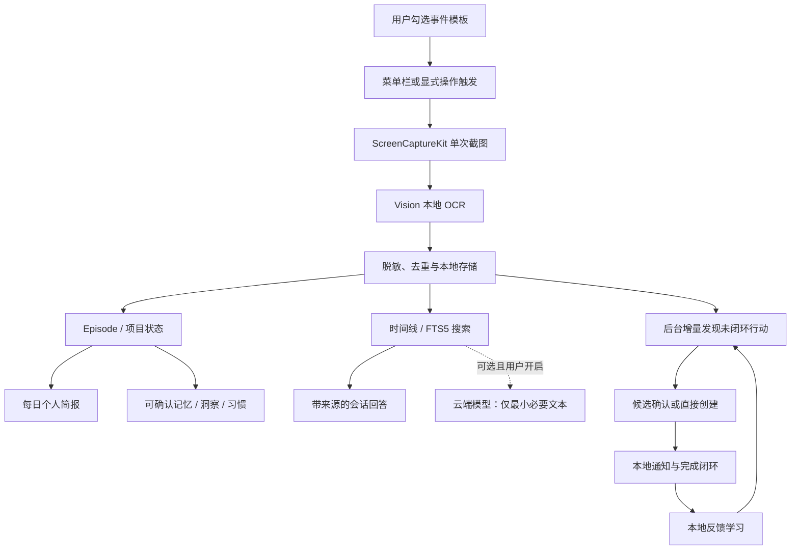

# Recall

> **找回经历、串联进展、接续思考的 macOS 个人记忆助手。**

Recall 将用户主动保存的记录整理为可搜索、可追溯的本地记忆，帮助回答“上次谈到哪了”“当时为什么这样决定”“这件事后来怎么样了”。记忆脉络把跨日期、跨应用的同一主题串联起来，每日总结回顾一天，问一问从积累中寻找答案，提醒承接用户明确安排的行动。随着记录积累，应用在有来源支持的前提下连接相关经历，帮助用户接续工作与思考；用户可以查看来源、更正内容或删除记录。

## 核心原则

Recall 的默认行为是 **本地优先、明确触发、可追溯、可删除**。它不会默认监听裸 Enter，不会默认连续截图，也不会默认把截图或完整历史发送到云端。用户可在“记录事件”中明确启用 Enter 键触发记录；该规则默认关闭、可随时暂停，且仅在 Recall 不在前台时响应。每条回答关联本地记忆来源；每个提醒都必须由用户确认后才能创建。

## 已实现功能

| 能力 | 当前实现 |
|---|---|
| 事件模板 | 提供 9 个可独立启用、配置和关闭的记录模板，包括手动记录、工作节点、网页研究、会议、待办、文档里程碑、任务切换、每日回顾和默认关闭的 Enter 键触发记录。 |
| 显式采集 | 使用菜单栏入口与“记录此刻”窗口触发；支持当前窗口、当前显示器与仅文本三种范围。 |
| 本地 OCR | 通过 `Vision` 的 `VNRecognizeTextRequest` 在设备端提取中文和英文文本。 |
| 本地记忆 | 将时间、来源应用、OCR、摘要、标签和可选截图保存在 `~/Library/Application Support/Recall/`。 |
| 记忆脉络 | 通过“进行中、全部主题、一周回顾”串联跨日期的具体事情与经历；支持补充记录、手动整理已有记录、查看来源和更正内容。 |
| 搜索与问答 | 提供时间线搜索和检索增强会话；长对话采用滚动摘要、最近消息窗口和独立记忆证据三层上下文管理。 |
| 个人简报 | 每日总结不再复述时间线，而是输出主线、真实进展、未闭环事项、最多 3 条洞察和下一步行动，并兼顾全天覆盖与高重要度事件。 |
| 项目与工作 Episode | 将相近时间、同一项目的记录聚合为工作 Episode，持续维护项目阶段、成果、阻塞和开放事项。 |
| 可校正的长期记忆 | 仅把明确表达的目标、偏好、约束、习惯和工作流作为候选；用户确认后才进入长期记忆，拒绝后不再采用。 |
| 反馈学习 | 洞察支持“准确 / 部分准确 / 不准确”；连续负反馈会抑制同类洞察。重复出现的工作模式只作为候选，用户启用后才影响建议。 |
| 本地智能索引 | JSON 保持兼容数据源，同时用 SQLite WAL + FTS5 建立可重建的本地搜索与智能状态索引。 |
| 模型接入 | 提供可编辑的 OpenAI 与 Anthropic 兼容接口；地址、模型、API Key 均可配置，密钥作为普通文本仅保存于用户本机 Recall 配置。 |
| 智能提醒 | 后台增量分析用户允许参与的本地记忆，过滤疑问、完成态、代码与界面噪声，识别待办、承诺、截止时间与重复周期；支持直接创建、确认候选、稍后提醒、修改、完成、取消、来源追溯和通知快捷操作。 |
| 隐私控制 | 支持暂停采集、截图开关、应用 Bundle ID 排除列表、基本敏感信息脱敏与记录删除。 |
| 记忆治理 | 支持时间线单条/批量删除、删除影响预览、总结条目级管理、彻底忘记来源、7 天最近删除与恢复，以及按删除原因学习的本地忽略规则。 |

## 信息流



## 时间线：短预览与完整证据

时间线以内容片段作为标题，记录方式（如 Enter 触发）降为辅助信息。两行预览由本地规则提取，过滤聊天角色标记、网址、独立导航文字和重复片段；它不调用云端模型，也不保证理解出完整语义。旧记录直接使用保存的 OCR 生成新预览，不改写原文或旧状态。没有清晰正文时，会明确提示查看原始记录。

原生聊天工具在单窗口采集时，先在本地识别会话列表、正文、标题和输入区。分隔线需要贯穿下方输入区，标题/输入边界还需覆盖两侧留白，避免把超长气泡和卡片底部错当窗口边界。背景从两侧留白采样；相邻气泡因压缩而粘连时按内部间隔拆开，头像和输入工具栏不进入消息正文。微信、企业微信、钉钉、Signal、Beeper 等采用左右气泡规则；飞书使用独立的左对齐样式规则，标准蓝色本人气泡和灰色接收气泡分别归属，不再统一按“左侧等于对方”。未知配色和无法定位气泡的文字标为角色未知，无法可靠定位正文时保留全文。此识别仍受应用版本、主题、布局和截图缩放影响，不能保证所有自定义主题都可归属；整屏及网页聊天不启用原生窗口裁剪。

Slack 原生窗口采用独立的频道解析：排除左侧工作区/频道列表、顶部频道工具栏和底部输入区，按可见姓名与时间分组消息，并保留频道名和聊天日期。加入频道、重命名、添加应用等单独标为系统事件；“几条回复”是按钮，不会补写未展开的线程。未显示作者的顶部残段保留为未知片段。当前没有 Slack 账号身份绑定，显示姓名不代表当前用户，因此这些发言保持角色未知，不自动当作用户自己的承诺、偏好或已完成事项。无法可靠定位边界时保留全文；网页版和整屏不启用此窗口裁剪。真实应用版本和自定义主题仍需实机校验。

聊天解析同时区分普通消息、显式引用资料和带文件大小的附件卡片。在“文件传输助手”的标题被识别时，大段保存文字保守视为资料；旁边的短个人评论仍独立保留。识别结果保留发送者及内容类型，资料/附件仍可搜索和查看，但不会直接生成用户偏好、已完成事项或提醒。保存文章不等于认同其中全部观点。其他未显式标注的转述/文章仍可能无法判断，模型需结合上下文区分。此规则作用于新采集，历史 OCR 没有保存文字坐标，不自动改写；更新后重新采集才能使用新规则。原截图保留和删除设置不变。

点击记录或右键选择“查看详情”，可查看来源应用、窗口、记录方式、完整识别文本和仍保留的原截图。识别文本支持选择和“复制全文”；截图未保留、已清理或无法读取时有明确说明。完整文本指当时截图的 OCR，仍只覆盖可见区域，可能包含识别误差。管理模式点击继续用于勾选，删除仍走原有确认与最近删除流程。

macOS 手动验收：确认普通点击打开详情、长文本可滚动并完整复制、截图正常展示、无截图/截图文件缺失时有说明、管理模式单选与全选正常、删除后记录退出时间线、恢复后详情重新可用。CI 验证摘要噪声过滤、正文保留、去重、长度限制、旧记录展示兼容和原始 OCR 保留；实际窗口交互需要在 Mac 上检查。

## 每日总结：先可信，再提供发现

每日总结只保留三个栏目：**今天推进了什么、接下来要处理、值得留意**。没有可靠行动或发现时隐藏相应栏目，不补足条数。

- **行动有归属**：保留聊天角色到每个句子。用户明确输入、用户自己的承诺、对方明确交给用户的请求可形成候选；无法判断角色的聊天、助手等待确认的提议、日志、配置状态和残句不生成待办。未标记来源的旧 OCR 仅保留明确的待办/提醒线索，不默认属于用户。
- **候选可被否决**：本地先校验具体对象、动作和完成/取消证据；开启模型后，模型结合完整上下文核准或删除候选，并通过候选 ID 改写标题。模型返回空数组时不会重新填入规则候选；无效模型响应才使用本地兜底。用户已关闭的提醒不会被当前总结再次列为行动。
- **发现有依据**：模型发现需要至少两条不同内容的来源记录；重复截图和缺少采集记录不能证明行为规律或项目停滞。识别把握和有日期不等于优先级，页面不再自动给第一条行动标“建议先做”。来源数量检查是最低门槛，不代表已经验证模型结论正确。
- **记忆不冒认**：自动沉淀偏好只接受可归属于用户的表达；重复截图或重复运行不会抬高记忆评分。新采集保存文本来源，旧记录兼容读取且保持来源未知。

这些规则作用于新生成的总结；旧总结加载时会清理已知的残句、助手提议和旧版“无采集即停滞”判断，但不会自动重写历史全文。需要完整重新核查时重新生成相应日期的总结。验证器使用合成对话覆盖角色延续、完成/取消、新旧状态兼容、模型否决与改写、来源校验和周期提醒。

## 智能提醒：让记忆在正确的时间重新出现

提醒不是把所有文字都变成任务，而是从已有记忆中找出**值得再次进入注意力的未闭环行动**。Recall 默认在启动、新记录写入、规则改变以及前台运行期间定时做增量分析；内容未变化的记录由哈希检查点跳过，因此数据增长后不会每次重新扫描全部历史。

- **更精确的发现**：只有用户允许参与提醒的事件类型会被分析；每日总结不会再作为输入重复产生候选。规则会过滤疑问句、已完成事项、日志、代码注释、导航菜单和过短标签，并合并同一事项的多条来源。
- **持续复核**：新证据写入时同时核查未确认候选；明确的同一对象完成/取消记录可以撤下旧候选。提取规则升级后自动重验一次，已安排的通知、手动提醒和用户处理结果不受自动重验影响。
- **时间与周期**：支持今天、明天、后天、星期、月底、明确日期、几分钟/小时/天后，以及中文上午/下午/半点等时间；可设置不重复、每天、每周或每月。
- **完整闭环**：候选由用户确认时间后才进入系统通知；也可以直接新建。已安排提醒支持修改、稍后、完成和取消，通知横幅可直接“完成”“1 小时后提醒”或“明天提醒”。点击通知会前置 Recall 并打开提醒页。
- **越用越贴合**：确认、忽略、完成和稍后操作只在本地形成反馈。重复忽略会降低同类弱候选的置信度；常用的确认/稍后时段会成为新提醒的默认时间。被忽略的候选 30 天内不会反复出现，新的发生日期仍可重新发现。
- **可控且可删除**：后台发现只读取已经保存的文本，不主动截图、不调用云端模型，也不会自动创建通知。删除来源记录会一并删除其派生提醒；手动提醒不受影响。提醒历史按页展示，过旧的完成/取消记录会自动清理，状态上限用于避免长期运行后无限增长。

默认页围绕用户当前最需要做的事组织：顶部显示“已过期 / 今天 / 接下来 / 待确认”，正文优先展示已安排事项，其次是待确认候选和历史，而不是展示内部处理流程。没有候选时会说明实际参与分析的记忆数量，并保留“新建提醒”和“重新分析”两个明确入口。

## 记忆治理：既能记住，也能正确忘记

Recall 将“删除一份总结”和“彻底忘记证据”区分为两个明确动作。前者只移除生成结果，保留原始记录以便重新总结；后者会让原始记录立即退出时间线、FTS 搜索、问一问上下文、每日总结、长期记忆和派生提醒，同时使相关日的智能状态在撤销窗口后基于剩余证据重新计算。由用户手动创建且没有来源关联的提醒不会被误删。

- **删除前可预见**：时间线支持管理模式、当天全选和批量删除；确认页会列出记录、截图、受影响总结、派生提醒、历史回答与智能状态数量。
- **删除后可恢复**：普通删除会进入本机“最近删除”并保留 7 天，界面即时提供撤销；可在“隐私与模型 → 记忆治理”中恢复或提前永久删除。
- **总结可逐项管理**：新旧每日总结都会转换为结构化条目，可只移除某个结论，也可沿其证据链彻底忘记关联记录。Markdown 仅作为兼容和导出格式保留。
- **聊天与派生状态同步清理**：引用被删除证据的助手回答会移出会话，长对话压缩摘要会失效；相关 Episode、项目状态、洞察、用户记忆、习惯和提醒随后从剩余证据重建。
- **从删除中学习**：删除时可选择“重复 / 不准确 / 不重要 / 敏感 / 不再需要”等原因，并可明确开启“以后也忽略相似内容”。匹配规则只保存在本机、可随时删除，默认不会因为一次删除自动扩大过滤范围。

## 聊天命令

在“问一问”的输入框键入 `/`，会在输入框上方显示命令菜单；继续输入可筛选命令。点击菜单项或按 Tab / 回车仅将命令填入输入框，发送后才执行。Escape 可收起菜单，Shift + Enter 继续用于换行。

目前支持 `/clear`：在本机清空当前会话的聊天记录和压缩上下文，显示“已清空当前会话，可以开始新的对话”。采集记忆、每日总结和提醒保留。清空操作不需要模型连接或 API Key；回答生成或打字机显示期间也能执行，旧请求的结果无法写回新会话。操作成功后重启仍保持清空状态；失败会显示执行失败并记录日志。未知命令或多余参数会返回使用提示。

## 快速开始

Recall 是一个原生 Swift Package 项目，要求 **macOS 14 或更高版本**。日常开发建议安装完整 Xcode；仅构建核心与运行验证器时可使用最新版 Xcode Command Line Tools。

```bash
git clone https://github.com/samz406/Recall.git
cd recall
swift build --jobs 1
./scripts/run-app.sh
```

首次记录截图前，请在 **系统设置 → 隐私与安全性 → 屏幕与系统音频录制** 中允许 Recall。应用只有在用户点击“记录此刻”或启用的特定事件触发时才请求屏幕内容。创建首个提醒时，macOS 会在用户主动点击“创建提醒”后请求通知授权；请使用 `./scripts/run-app.sh` 启动，因为本地通知需要带 Bundle 标识的 `Recall.app`，而不能直接运行原始 SwiftPM 可执行文件。

> 在本仓库当前开发环境中，完整 Xcode 尚未安装，因此使用 `swift build` 和 `swift run RecallVerifier` 验证核心逻辑。`scripts/run-app.sh` 会把当前构建包装成开发用 `Recall.app` 并启动它。安装完整 Xcode 后，可直接打开 `Package.swift` 进行界面调试、签名与发布。

## 验证

项目提供无网络、无真实截图、无真实云端密钥的集成验证器。它覆盖事件规则、隐私脱敏、应用排除、模拟截图到 OCR 的记录管线、重复记录拦截、检索排序、提醒精度与去重、相对/中文时间、重复周期、完成与忽略生命周期、本地反馈学习、来源删除联动、扫描检查点、通知宿主保护、本地持久化、自定义模型连接配置、长对话压缩、可追溯回答、Episode 聚合、重要记录选择、洞察反馈、习惯学习、SQLite FTS5 与旧状态迁移。另提供可选的真实 Anthropic 兼容服务探测。

```bash
swift build --jobs 1
swift run RecallVerifier
```

成功输出如下：

```text
PASS: RecallVerifier completed 53 integration checks.
```

## 事件模板

| 模板 | 默认状态 | 说明 |
|---|---:|---|
| 手动记录此刻 | 启用 | 从菜单栏或“记录此刻”窗口保存当前工作节点；默认参与提醒发现。 |
| 当前窗口工作节点 | 启用 | 适合在白名单应用内以组合快捷键创建阶段性记录；默认参与提醒发现。 |
| 网页研究摘录 | 关闭 | 用于用户主动保存网页研究材料。 |
| 会议开始与结束 | 关闭 | 用明确操作建立会议相关记录；不录音、不后台持续截屏；启用后参与提醒发现。 |
| 待办或承诺创建 | 启用 | 保存用户确认的待办，允许提出提醒候选。 |
| 文件或文档里程碑 | 关闭 | 保存文档、设计稿或代码的阶段性上下文；启用后参与提醒发现。 |
| 任务切换复盘 | 关闭 | 在任务切换时记录用户主动填写的复盘；启用后参与提醒发现。 |
| 定时个人回顾 | 启用 | 汇总已有显式记录；不会在定时点额外截图，也不会被再次扫描为提醒。 |
| Enter 键触发记录 | 关闭 | 由用户明确启用后，在 Recall 不在前台时监听 Enter 并记录当前窗口；可随时暂停。 |

## 隐私与模型

本地 OCR、搜索、摘要回退、提醒候选与数据持久化均可离线运行。截图文件、JSON 状态和模型 API Key 默认位于 `~/Library/Application Support/Recall/`。API Key 作为本机普通文本配置保存；它不会写入日志或 Git 仓库。

用户可在“隐私与模型”中选择**兼容 OpenAI API**或**兼容 Anthropic API**，并自行编辑地址、模型名称与 API Key。云端模式仍只会发送当前问题、经过基础脱敏的检索证据、压缩摘要和最近会话窗口；云端模式未启用或未配置密钥时，会话会回退到本地可追溯摘要。详见 [隐私设计](docs/PRIVACY.md)。

## 项目结构

```text
Sources/
  RecallApp/       SwiftUI 应用、菜单栏入口、时间线、会话与设置界面
  RecallKit/       采集、OCR、隐私、记忆、会话、提醒与持久化核心
Verification/      无外部依赖的集成验证器
docs/              架构、隐私与贡献说明
.github/workflows/ CI 配置
```

## 贡献与路线图

欢迎提交 issue 和 pull request。提交前请阅读 [贡献指南](CONTRIBUTING.md)、[个人智能设计](docs/PERSONAL_INTELLIGENCE.md) 与 [安全政策](SECURITY.md)，并运行验证命令。后续重点包括真正的全局组合快捷键注册、可选向量检索、端到端加密同步、更精细的敏感页面排除和无障碍审计。

项目以 [MIT License](LICENSE) 发布。

### 记忆脉络：把零散的记录，串成可以接续的经历

应用默认打开“记忆脉络”，以具体主题组织已经保存的本地记录。页面保留三个浏览入口；右上角提供“整理已有记录”“补充记录”，更多菜单中可以查看“更正记录”和开关历史经验提示。

无需等待满七天或先生成每日总结：启动、采集和更新记录后都会在本地重新整理。右上角的 **整理已有记录** 可以手动重跑，并显示检查的记录数和整理结果；没有符合条件的记录时说明原因，不会强行生成档案或调用云端模型。

也可以点击 **补充记录**，填写主题名称、内容、状态和发生时间，立即在“全部主题”中查看。后续同名记录会串联在一起；“仅作记录”不会计作正在推进或近七天进展。补充的内容同时保留一条标明手动输入的文字来源，可在记忆时间线查看、删除，并按现有七天期限恢复。不会截图，也不会因选择“待处理”而自动安排通知。发生时间与保存时间分别记录，不能把未来时间作为已经发生的进展。

- **进行中**：展示能确认归属、对象明确的待处理、推进中和受阻主题，可查看完整脉络与来源，或带着主题进入“问一问”。浏览文章、助手回复、角色不明的截图不会自动成为“我正在做的事”。没有进行中的主题时，可前往“全部主题”回看已完成和仅作记录的内容。
- **全部主题**：把同一主题的记录跨日期串联，每段保留原始来源，包含进行中、已完成与仅作记录的主题。支持搜索主题或内容，每次加载 20 条；归类不对时可以更正。
- **一周回顾**：按主题展示滚动最近七天的不同记录及状态，并对照更早的记录；每张卡片展示最近三次变化，完整过程可进入主题查看。连续重复截图只增加来源，不计作新进展，重新浏览旧结果也不会制造近七天变化。
- **历史经验提示**：默认关闭，在右上角更多菜单中开启。开启后，在“进行中”最多展示一条与近期主题相关、由独立来源支持的历史完成结果。提示说明适用条件可能不同，可以看来源或永久忽略这一条；不会发送系统通知或执行外部动作。
- **更正记录**：从右上角更多菜单打开独立窗口，回看对归属、完成状态、主题或发生时间的调整，支持分页和查看来源。原始截图和文本保留；错误归属/结论的来源停止用于推断与检索，标记完成时关闭关联提醒。删除更正后重新使用原始记录，但不会自动重新安排已关闭的提醒。

没有主题时，页面说明如何开始并提供“补充记录”和“整理已有记录”；搜索无匹配和暂无进行中主题分别显示对应提示。页面标题和切换入口固定在滚动区域之外，较窄窗口会将操作和搜索换行，正文保持独立滚动。

“进行中”使用具体对象与本人明确状态组织内容，不再借用提醒关键词判定待办。“正在编写程序代码”等缺少对象的信息、文章观点、教程步骤和泛指重试不会自动成为主题；历史 Episode 的旧标题、旧状态同样需要重新核对原文。卡片分别展示“上次进展”与有来源的“后续行动”，不把后面的待办覆盖成整件事的进展，也不会编造下一步。正文保留完整原句，原始记录可以查看和删除。

超过两周没有新进展的未闭环主题，默认折叠在“较早的记录”并标为“状态待更新”，不会自动认定已完成或仍在推进；搜索时会展开匹配的较早主题。“补充进展”会带入已有主题名称，方便记录当前情况。重复截图只增加来源，不能刷新旧进展的日期；用户明确补记的状态会作为新的确认保留。这些检查在本地重建时应用，已有记录也会更新展示，无需删除后重新采集。

“问一问”按问题选择证据：历史方法优先查结果，决定类查取舍，状态/变化类兼顾早期与最近来源，多日回顾保持日期覆盖。重复截图不应挤占上下文；已关闭参与聊天的采集来源及其派生内容不会进入问答。发生时间和采集时间分开表达，只有用户明确更正的发生时间才替代时间过滤依据。

所有 Tab 共用原始证据校验：网页/工具名称不能直接作为事项，旧的截断摘要不再作为正文；使用完整原句，状态与原句归属对应。旧档案也在每次重建时重新检查，不需要删除原始记忆。无法确认归属或缺少明确对象的内容仍可在记忆时间线查看。用户主动另归类的资料可以保留在档案中，但不自动算作进展或进入周回顾。

这些整理在本地运行，不增加采集和云端调用。问答仍遵守现有的云端开关与脱敏规则。归类采用保守主题规则，不能保证自动理解所有跨应用别名；所有进展都是记录中的状态，不是对现实完成情况的独立验证。历史经验属于可查阅的参考，不表示已验证能解决当前问题。受纠错影响的旧总结不会继续作为问答证据；旧总结页面仍保留原文，可删除或重新生成。删除来源时，档案同步移除，纠错随来源进入最近删除并支持恢复。
