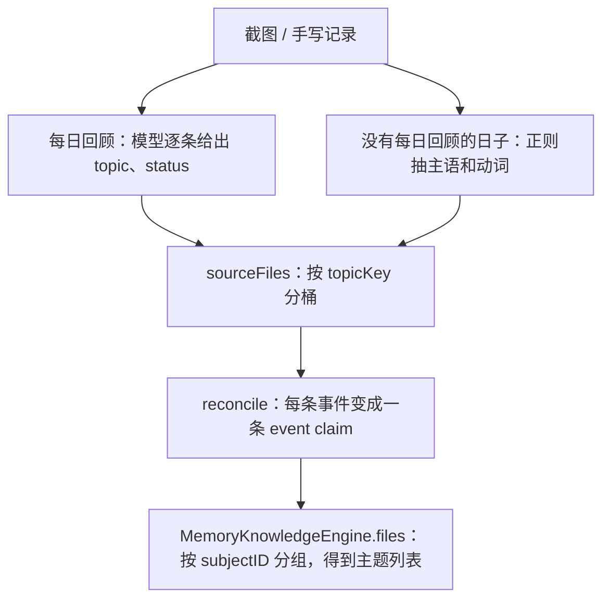
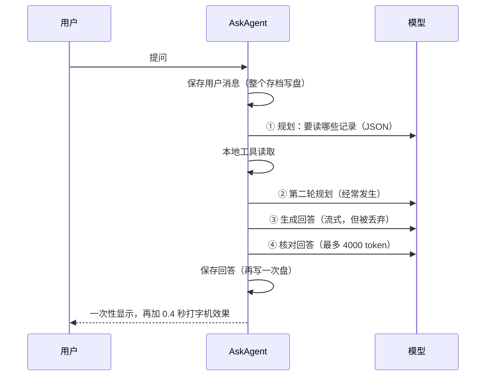

# 记忆主题与问一问：现状分析与优化方案

日期：2026-11-25。本文基于代码阅读，未做实测；耗时类判断需要用诊断日志中的“问一问耗时”数据确认。

## 1. 主题列表展示

### 现状

卡片在 `Sources/RecallApp/Views/MatterWorkspaceView.swift:110`，摘要来自 `TopicReading.overview`（`Sources/RecallKit/Memory/MemoryExperience.swift:23`）：只有生成过且仍是最新的“更新小结”才显示主题级概述，否则回退为 `file.latest.detail`，即最后一条事件的原文，最多 3 行。

### 问题

| # | 问题 | 位置 |
|---|---|---|
| 1 | 摘要是最后一条事件原文（`title：detail`），PR 号、环境变量、表名等执行细节堆满 3 行 | `MatterWorkspaceView.swift:119-120` |
| 2 | 状态与正文矛盾：正文“已修复/已解决”，状态仍显示“正在推进” | `MatterWorkspaceView.swift:117` |
| 3 | 每张卡都有“继续问”和 `…`，重复操作抢占视觉权重 | `MatterWorkspaceView.swift:127-135` |
| 4 | “最近更新”标签与“筛选 → 全部”效果相同（都是 `filter = 0`），标签始终选中，没有作用 | `MatterWorkspaceView.swift:56-61` |
| 5 | 完整日期加来源数量，列表层价值低 | `MatterWorkspaceView.swift:124` |
| 6 | 单卡约 270pt 高，一屏约 4 个主题，扫读效率低 | 整体 |

### 优化

1. 摘要一句话，1–2 行。优先使用最近事件的 `title`（每日回顾已经生成了“具体事情”），细节留到详情页。
2. 操作改为悬停显示或放进右键菜单；点整张卡进详情，详情页已有“继续问”。
3. 用状态色点表示状态，按“进行中 / 已完成”分组，已完成默认折叠。
4. 筛选合并为一个分段控件：全部 / 进行中 / 已完成。
5. 元信息只保留相对时间（昨天、3 天前），来源数量放到详情页。

目标形态：

```text
● 聊天多段回复合并                                   昨天
  历史气泡误挂"思考中"表情的问题已定位并修复
```

## 2. 主题提取逻辑

### 现状链路



- 主路径：每日回顾提示词（`DirectDailyReview.swift:314`）要求模型为每个条目写 4–30 字的 `topic`，只有一句“同一件事在不同日子用同一个名字”的约束。
- 归并键：`MatterEvidence.key`（`MatterEvidence.swift:68`），转小写后去掉标点和空格，再做精确匹配。
- 兜底路径：`MatterEvidence.entries` 用正则从句子中抽“主语 + 动词”作为主题，状态也靠关键词判断（`MatterEvidence.swift:110-153`）。
- 主题状态 = `MatterFile.latest.status`，卡片正文 = 最后一条事件的 `title：detail`（`DailyKnowledge.swift:141`）。

### 问题

| # | 问题 | 后果 |
|---|---|---|
| 1 | 模型生成主题名时看不到已有主题，提示词没有传入现有主题名 | 同一件事不同叫法被拆成多个主题，只能手动合并 |
| 2 | 归并只做字符串精确匹配；`MemoryEntity.aliases` 字段存在但归并时没用 | 用户合并过一次，下次模型换个叫法又会拆开 |
| 3 | 没有主题粒度约束，一天内每个事项都起一个主题 | 主题过碎、列表过长，每个主题来源很少 |
| 4 | 主题状态取最后一条事件；模型默认填 `inProgress`，未知状态映射为 `.explored` | 正文已完成但状态仍是“正在推进”；完成后再记一条又被拉回推进中 |
| 5 | 卡片正文是单条事件，主题级 overview 要手动“更新小结”才有 | 列表“内容多”的根源 |
| 6 | 正则兜底和模型路径的命名风格不一致 | 历史主题与新主题接不上，产生重复 |

### 优化

1. 每日回顾时传入最近 30 天活跃主题名，要求“能归入已有主题就原样复用这个名字”。只传主题名，不传原文，符合最小化原则。
2. 归并时使用别名：用户合并后把旧名写入 `aliases`，`topicKey` 查找时先映射到主题。
3. （产品决策）增加粗粒度 `project` 层级，列表按项目分组。
4. 主题状态改为推断，不直接取最后一条：有明确的完成证据算完成；14 天没有动静算搁置（复用 `needsStatusUpdate`）；用户手动标记优先。
5. 卡片正文使用最近事件的 `title`，不用 `title：detail` 拼接的长文。
6. 逐步淘汰正则兜底路径，只在无模型环境下保留，并把它产出的主题标为“待确认”。

## 3. 主题随时间的演进

### 现状

| 方面 | 行为 | 位置 |
|---|---|---|
| 主题 ID | `"topic:" + topicKey(名字)`，名字即身份 | `DailyKnowledge.swift:138` |
| 显示标题 | 同一个键下最新一天的名字 | `DailyKnowledge.swift:149`、`MemoryKnowledge.swift:759` |
| 归入同一主题的条件 | 规范化后的名字完全一致 | `MatterEvidence.swift:68` |

显示名只在写法略有差异时会更新；叫法一旦有实质变化就会断开，成为新主题：


### 问题

1. 事情演进就断档：旧主题停在“正在推进”，这是列表堆积的来源之一。
2. 用户操作挂空：合并组（`MemoryTopicGroup.memberIDs`）、完成标记（`topicID`）、主题小结（`topicReviews`）都挂在由名字决定的 ID 上；名字变化后，新事件落到新 ID，这些操作不会跟过去；重新生成每日回顾后可能整体失效。
3. 没有生命周期：`needsStatusUpdate`（14 天）只用在历史经验提示里，旧主题不会退场。
4. 拆分和收拢都无法表达，只能手动合并。

### 优化：身份与名字分离

引入持久化的主题登记表：

```text
Topic {
  id: UUID                 // 稳定身份，合并、完成、小结都挂在这里
  title: String            // 当前显示名，可以演进
  aliases: [String]        // 曾用名；用户合并后，旧名写进来
  state: active | dormant | done | archived
  parentID: UUID?          // 可选：项目层级
}
```

- 每日回顾传入活跃主题的 `id + title`，模型返回 `topicID`（归入已有主题）或 `newTopic`（新建）。
- 改名只更新 `title`，旧名进入 `aliases`，ID 不变。
- 生命周期：14 天没有新事件自动转为 `dormant` 并折叠；有新事件自动唤醒；用户标记完成为 `done`。
- 迁移：现有 `topic:key` 映射为登记表条目，旧 key 写入 `aliases`，已有的合并组和完成标记继续生效。
- 删除主题时，要连带处理别名和挂在它上面的会话、小结，满足“可删除、可追溯”。

路线：先做第 2 节的 1 + 2（传入主题名、使用别名）作为过渡，再引入登记表和生命周期。

## 4. 问一问的响应速度

### 现状链路（Agent 路径）



### 卡顿原因

| # | 问题 | 位置 | 影响 |
|---|---|---|---|
| 1 | 流式回调为空：`answerStream(to: request) { _ in }` | `AskAgent.swift:126` | 要等回答和核对都结束才看到第一个字 |
| 2 | 串行 3–4 次模型调用（规划最多 2 轮、回答、核对） | `AskAgent.swift:72-132` | 首字延迟 ≈ 所有调用之和 |
| 3 | Agent 任一步失败就回到 `MemoryAssistant` 重跑完整流水线（检索、语义补查、回答、再核对） | `MemoryAssistant.swift:92-96, 180-258` | 最坏约 6 次调用，前面的耗时白费 |
| 4 | 核对把回答改写成“结论 [1]”列表；失败时退化为原文摘录 | `AnswerGrounding.swift:138-142, 166` | 等得久，结果读起来生硬 |
| 5 | 每条消息触发整个存档写盘（`addMessage` → `writeState` 编码包括 OCR 在内的整个 state），并占住 store actor | `Storage.swift:1378-1389, 1606` | 存档越大越慢 |
| 6 | 每次模型调用前，`LiveMemoryResponder.validate()` 都对所有截图逐条比较 `searchableText` | `LiveMemoryResponder.swift:26-27` | 每次提问执行 3–4 遍，O(全部文本) |
| 7 | `MemoryAssistant` 标了 `@MainActor`，回退路径的检索和排序在主线程执行 | `MemoryAssistant.swift:3, 99-178` | 可能造成真实的界面卡顿 |
| 8 | 最终回答请求同时带 `context: shown` 和内容基本相同的 `transcript` | `AskAgent.swift:117-121` | token 近乎翻倍 |

### 优化

1. 草稿与核对的取舍（需要产品决策；与 `AnswerGrounding.swift:33` 的“核对前不流式输出”约束冲突）：
   - A. 流式显示草稿并标为“核对中”，核对后替换为定稿，删除的句子划掉。
   - B. 保持不展示草稿，但核对先跑本地确定性检查（引文、数字、日期、完成状态），只有涉及完成、上线、日期等结论时才调用模型核对。
2. 先做本地检索，把候选摘录放进第一次规划，让大多数问题一轮就能回答。
3. 核对只返回不被支持的句子编号，在原回答中删除，不重写全文。
4. 给整次提问设时间预算；Agent 中途失败时，用已经读到的材料直接回答，不重跑整条回退流水线。
5. 工程修复（不改变行为）：
   - 会话消息改存 sidecar 文件（参考 `reviewSchedules`），不再写整个存档。
   - `validate()` 改为比较修订号（`archiveRevision` / `dataGeneration`）。
   - 把 `MemoryAssistant` 的检索移出主线程。
   - 最终回答请求去掉与 `shown` 重复的 `transcript`。

## 5. 问一问的上下文管理

### 问题

1. 两套机制互不相通：Agent 路径用 `historyBlock`（最近 6 条，每条 300 字，拼进问题文本，不读滚动摘要）；回退路径用 `ConversationContextManager`（最近 8 条加滚动摘要）。同一个对话，模型看到的上下文取决于走哪条路径。
2. 滚动摘要不是真正的摘要：`compact` 只是把旧消息各截 360 字后拼接，再截到 4000 字（`LLMClient.swift:369` 起）；主路径不用它，每次都白写盘。
3. 追问不复用上一轮的来源：上一条回答的 `citations` 已保存，追问时却重新检索；指代消解只是在出现“这个”“它”时拼上上一个问题（`MemoryAssistant.swift:391`）。
4. 全局只有一个会话：从主题进入“继续问”只切换 `chatScope`，历史消息还是同一串，主题 A 的对话会带进主题 B。
5. 目录（30 天逐日计数、应用列表）每轮规划都重新发送，第二轮还要再加上完整 transcript。

### 优化

1. 统一为结构化的会话状态：当前主题、当前时间范围、上一轮引用的来源 ID，加最近 N 轮对话。追问时上一轮来源优先作为候选。
2. 删除基于截断拼接的滚动摘要，由上面的结构化状态替代。
3. 每个主题一个会话：从主题点“继续问”时打开或恢复该主题的会话；删除主题时连带删除它的会话。
4. 目录只在第一轮发送，第二轮只发增量的工具结果。

## 6. 推进顺序

| 阶段 | 内容 | 风险 | 是否需要决策 |
|---|---|---|---|
| 0 | 导出诊断日志中的“问一问耗时”，确认瓶颈和回退频率 | 无 | 否 |
| 1 | 问一问工程修复（第 4 节优化 5） | 低，不改行为 | 否 |
| 2 | 主题列表 UI（第 1 节优化 1、2、4、5） | 低，只改 UI | 否 |
| 3 | 每日回顾传入已有主题名 + 别名归并（第 2 节优化 1、2） | 中，改提示词和归并逻辑 | 否 |
| 4 | 减少调用次数：本地先检索、核对只删句子、失败用已有材料回答（第 4 节优化 2–4） | 中 | 否 |
| 5 | 草稿展示策略 A/B（第 4 节优化 1） | 中 | 是 |
| 6 | 主题登记表与生命周期、状态推断（第 3 节；第 2 节优化 4） | 高，涉及数据模型和迁移 | 是 |
| 7 | 结构化会话状态、每个主题一个会话（第 5 节） | 中高 | 是 |
| 8 | 项目层级（第 2 节优化 3） | 高 | 是 |

验证：核心逻辑修改后运行 `swift build --jobs 1` 和 `swift run RecallVerifier`；为“同一件事不同叫法归到同一主题”“改名后合并与完成标记仍然生效”“追问复用上一轮来源”增加验证夹具。UI 改动需要在完整 Xcode 环境中手动验收。

## 7. 实测结论（阶段 0）

数据来源：本机诊断日志中的 `问一问耗时`（时间跨度 2026-11-06 至 2026-11-16，44 条步骤记录、7 次完整回答）。只统计耗时数字，未导出任何原文。

| 步骤 | 次数 | P50 | P90 | 最大 |
|---|---|---|---|---|
| `answer`（最终回答模型调用） | 7 | 4.1s | 9.0s | 9.9s |
| `planning` | 5 | 0.97s | 2.1s | 2.3s |
| `analysis`（读取并准备存档） | 9 | 0.2s | 6.5s | 31.3s |
| `overview-local` | 8 | 0.12s | 0.12s | 0.12s |
| `tool:*`（get_overview / search_records / list_days / get_topic） | 12 | 15–31ms | — | 31ms |
| `retrieval` | 1 | 0.15s | — | 0.15s |

结论：

1. 本地环节不是瓶颈。所有工具调用都在 31ms 以内，检索 0.15s；耗时集中在模型调用。
2. 最终回答一次调用 P50 已达 4.1 秒、P90 9 秒。这正是 `answerStream(to:) { _ in }` 丢弃流式内容造成的可感知延迟——首字要等整段生成结束。
3. 规划只出现 5 次而回答 7 次，说明部分问题走了免规划路径；规划本身 P50 不足 1 秒，两轮规划最多约 4.6 秒，是首字延迟里可以省掉的部分。
4. 回退共 3 次：1 次 `agent-fallback:answer-call`（回答调用失败后整条重跑，第 4 节问题 3 的真实发生），2 次核对拒收（`claims-rejected`）。回退不频繁，但每次都是全部耗时白费。
5. **测量缺口**：日志里没有“单次提问总耗时”，也没有核对调用（`answerVerification`）的耗时——`grounding:*` 只在核对给出原因时记录 0ms。因此核对耗时只能靠 `answer` 与用户感知之差推断。建议在实现阶段补一个 `ask-total` 采样点，否则第 4 节的优化无法前后对比。

据此调整优先级：第 4 节的 1（草稿与核对）、2（本地先检索减少调用）、4（时间预算）直接命中真实瓶颈；第 4 节 5 的工程修复里，`validate()` 与 sidecar 属于降低长尾与存档膨胀，收益取决于存档大小，`analysis` 最大 31 秒说明大存档下这条路径确实会卡。
